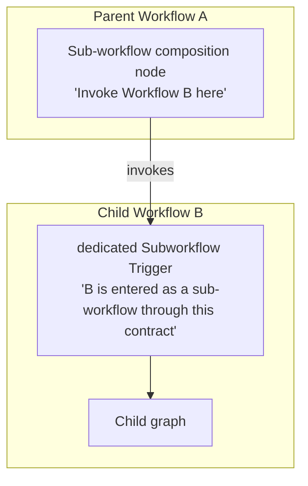
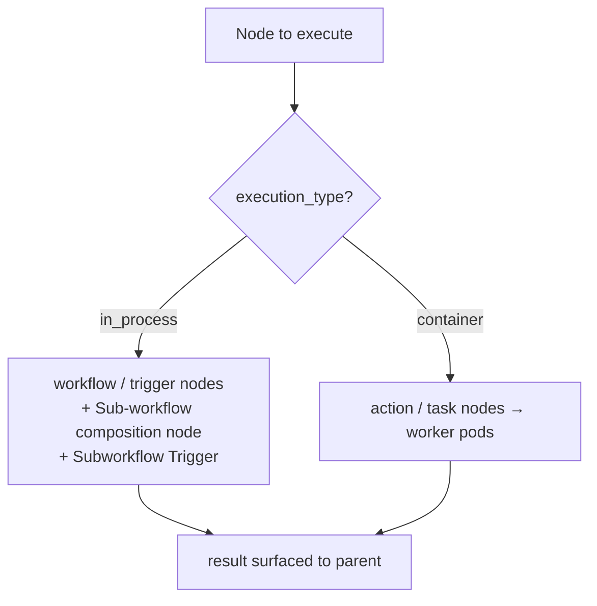
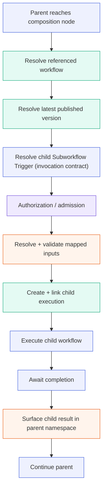
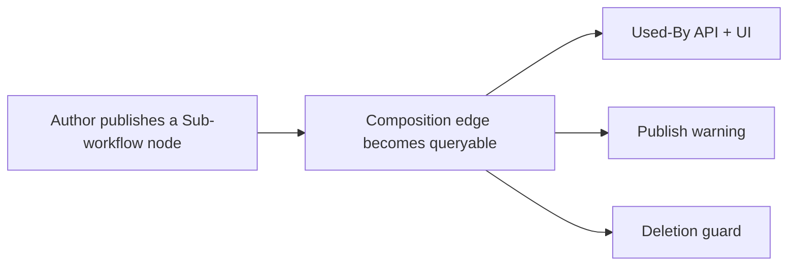
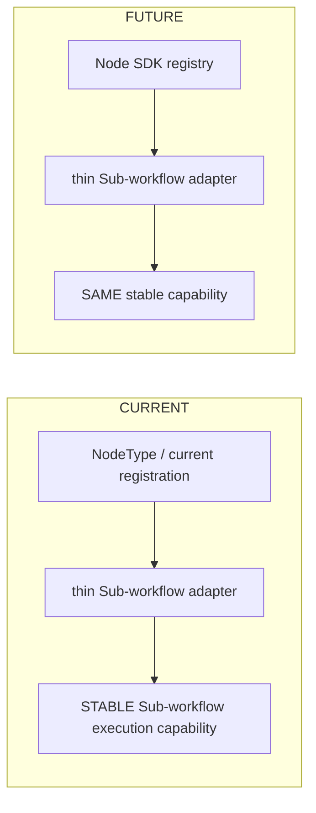

# Sub-workflow Node

The Sub-workflow Node lets an Automation Orchestrator workflow invoke another published workflow as a composable, reusable unit. This document describes the composition model (a parent-side composition node and a child-side invocation boundary), the runtime execution flow, and the versioning, dependency, and authorization behavior that make composition safe. It aligns with the Automation Orchestrator Node SDK where practical.

## Modes: Reference vs Embed

| Mode | What it is | Runtime relationship |
|------|-----------|----------------------|
| **Reference** | The parent references a target workflow and invokes it at runtime; the child always resolves to its latest published version. | Live parent↔child execution link. **This document.** |
| **Embed** | A design-time copy of a published workflow's nodes onto the parent canvas, as editable copies. | None — after copy, the nodes are ordinary parent nodes. |

Embed is a builder-side transform with no runtime execution path; the rest of this document describes **Reference mode**. Reference and Embed have different eligibility: Reference requires the child to expose a dedicated Subworkflow Trigger (see [Authorization & lifecycle safety](#authorization--lifecycle-safety)); Embed is a design-time import governed by ordinary workflow permissions.

## Conceptual model: two roles

Sub-workflow composition has two distinct roles, held by two different definitions. They are not the same node.



The **parent-side composition node** is a caller ("invoke Workflow B here"). The **child-side Subworkflow Trigger** is the entry contract ("B is entered as a sub-workflow through this contract"). They are kept separate so each can evolve independently; the parent's node identity does not depend on the child's trigger representation.

### Parent-side composition node

A control-plane node in the parent that references a child workflow and invokes it.

### Child-side invocation boundary — the dedicated Subworkflow Trigger

A sub-workflow invocation enters the child through a dedicated Subworkflow Trigger. The model is:

- a workflow is invocable as a sub-workflow only if it exposes a dedicated Subworkflow Trigger;
- a sub-workflow may be entered only through that Subworkflow Trigger;
- a Subworkflow Trigger may be invoked only by a Sub-workflow node;
- generic workflow triggers (manual / webhook / EDA / scheduled) do not establish sub-workflow eligibility.

The dedicated trigger is also what makes a sub-workflow run distinguishable from a manual run. Its persisted representation is a Node SDK integration point (see [Integration points](#integration-points-node-sdk)).

## Placement in the platform (taxonomy)

Both roles run in-process — a control-plane composition node and a trigger-category child ingress — with no isolated runtime to provision. The child workflow may itself contain container-backed action/task nodes, dispatched to the execution plane as usual; composition adds no container of its own.



## Child invocation contract

Two kinds of data must not be conflated: the business invocation contract the parent author sees, and the internal execution context the orchestrator manages.

### Business invocation schema

The author-facing contract — "what inputs does Child B expose?" — is domain data (e.g. `customer_id`, `region`, `environment`). The dedicated Subworkflow Trigger is the child-side invocation boundary. The child inputs exposed through that boundary are surfaced as configurable inputs on the parent Sub-workflow node.

### Internal execution context

Orchestration metadata the engine manages — parent execution id, actor identity, resolved child published version, invocation depth, request/correlation id — is not a user-authored input contract. It belongs to execution context, node settings, or platform configuration, not to the public invocation schema.

### Input mapping

Input surfacing and mapping are configured on the parent Sub-workflow node; child inputs are not promoted into the parent workflow's workflow-level input contract. Mappings are node-local and reuse the existing `${...}` expression machinery. The behavior of extra or unmapped inputs is governed by the child's schema validation.

## Output handling

The child's terminal result is available to downstream parent nodes.

## Runtime execution flow



Responsibility lanes:

| Step | Responsibility |
|------|----------------|
| Reach composition node; resolve entry contract; execute & await child; continue | Temporal workflow logic (deterministic, replay-safe) |
| Resolve referenced workflow; resolve latest published version; create + link child execution | Database work (read sessions not held across the child-start RPC, per the existing scheduled-launch pattern) |
| Resolve + validate mapped inputs; surface child result | Activity / backend-service work |
| Authorization / admission | Authorization / policy boundary — Subworkflow-Trigger eligibility and execute-permission, both before the child starts |

**Replay-safety invariant.** Child-workflow start is replay-safe under Temporal replay: replaying the parent must not create a second child execution. This correctness property is distinct from the node's retry policy and from business idempotency (see below).

## Failure, retry & idempotency

Three concerns are distinct and must not be collapsed:

- **Temporal replay safety** — a replayed parent must not start a duplicate child. A determinism property of the engine, not a user-facing retry.
- **Node retry policy** — `retry_policy` behaves as on any other node. An intentional retry may re-run a child that already performed work, so repeated business side effects are possible.
- **Business idempotency** — making a child safe to invoke more than once is the workflow designer's responsibility, not a platform guarantee.

`continue_on_failure` is separate again: it controls whether downstream parent nodes run after a failure; it does not retry anything. Deterministic child identity addresses replay safety, not business idempotency.

## Versioning & dependency safety

### Always-latest resolution

Each invocation resolves the child's current published version; a workflow has at most one published version at a time, and publishing a new child version is immediately picked up by every referencing parent. Resolution and dependency checks operate on published workflows only — drafts are not invocation targets, and draft references do not block deletion.

### Dependency is queryable

Every composition edge (parent references child) is queryable as a workflow dependency, supporting a Used-By view (which workflows reference this one), a publish warning (when publishing a workflow that is referenced by sub-workflow nodes), and a deletion guard (deletion is blocked while a workflow is actively referenced).



### Version drift

Because Reference mode always resolves the latest published child, publishing a new child version can make an existing parent incompatible; this is a workflow-design compatibility concern rather than a special responsibility of the Sub-workflow Node. If a run fails because of an incompatible change, the failure is clear and actionable — an error naming the specific mismatch — rather than a silent or misleading partial run. The UI may notify users that a referenced workflow changed, and design-time compatibility feedback may also be offered.

## Authorization & lifecycle safety

### Sub-workflow eligibility is trigger-based

A workflow is invocable as a sub-workflow because it exposes a dedicated Subworkflow Trigger — not because of a separate capability flag; generic workflow triggers do not establish sub-workflow eligibility.

### Execute-permission

Independently of eligibility, the invoking actor must hold execute-permission on the child before child execution starts, enforced through the platform's RBAC/authorization substrate.

### Child-metadata disclosure

Child metadata used for input/output discovery is exposed only through the applicable authorization boundary: an author who lacks the relevant permission on the child must not obtain the child's internal contract through the composition surface.

## Cycle & depth protection

Sub-workflow composition must prevent unbounded recursive invocation. The concrete cycle-detection mechanism and nesting-depth policy are being finalized as part of the feature architecture.

## Frontend / builder UX

The builder provides a palette entry with a reference-configuration form; a variable picker to map parent values into the child (rendered from the child's current input schema); a nested output picker over the child's result shape; and inline expansion of child results in the execution view. When an author references a child they lack permission on, only authorized metadata is shown (see [Child-metadata disclosure](#child-metadata-disclosure)).

## Integration points (Node SDK)

The runtime composition capability is kept stable and independent of node registration/identity. How node registration/identity is ultimately represented is an integration seam that requires alignment with the ANSTRAT-2422 Node SDK; it is not an approved contract yet. The intended separation:



**Intended stable capability** (target: unchanged across SDK migration, pending ANSTRAT-2422 alignment): latest-version resolution, authorization/admission, input mapping, input validation, child execution creation, lineage, child execution invocation, result/error handling.

**SDK integration layer** (pending ANSTRAT-2422 alignment): node registration, node identity representation, schema registration, palette metadata, SDK descriptor/manifest representation.

## Examples

Parent composition node and child ingress are different definitions. The node-type strings and schema shapes below are **illustrative**, not finalized Node SDK contracts.

```yaml
# Parent Workflow A  —  composition node

- id: process_payment
  type: sub_workflow
  parameters:
    workflow_id: "a1b2c3d4-e5f6-4a5b-8c9d-0e1f2a3b4c5d"   # child definition (resolved to latest published)
    input_mapping:                                          # node-local mapping; reuses ${...}
      order_id: "${trigger.order_id}"
      amount: "${validate_order.total_amount}"
  # settings: continue_on_failure, retry_policy.
  # retry_policy behaves as standard node retry; the workflow designer owns business idempotency.
```

```yaml
# Child Workflow B  —  invocation boundary

trigger:
  type: subworkflow_trigger    # dedicated Subworkflow Trigger — the only sub-workflow entry point
  input_schema:                # business invocation contract (illustrative shape — not a finalized SDK schema)
    order_id:
      type: string
      required: true
    amount:
      type: number
      required: true
# internal execution context (parent execution id, depth, actor, resolved version, correlation id)
# is orchestration metadata — NOT part of this public input schema
```

> The parent composition node is not the child ingress trigger; they remain distinct roles.

---

*Reference-mode Sub-workflow Node behavior for the Automation Orchestrator workflow engine.*
