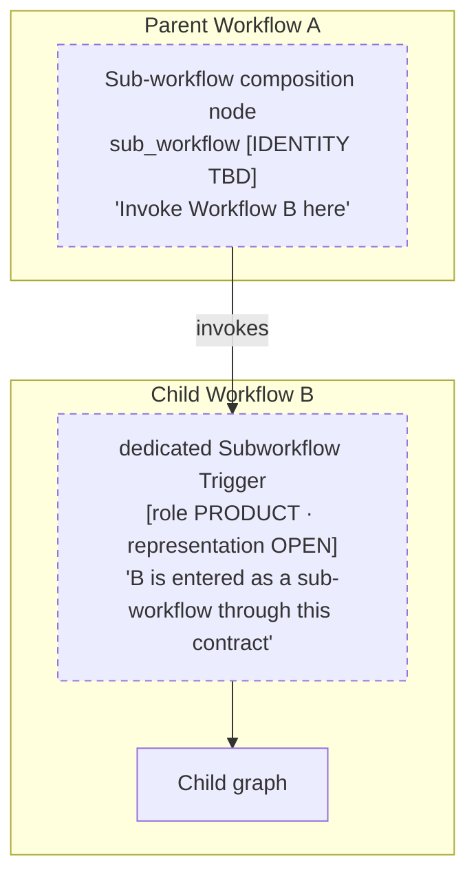
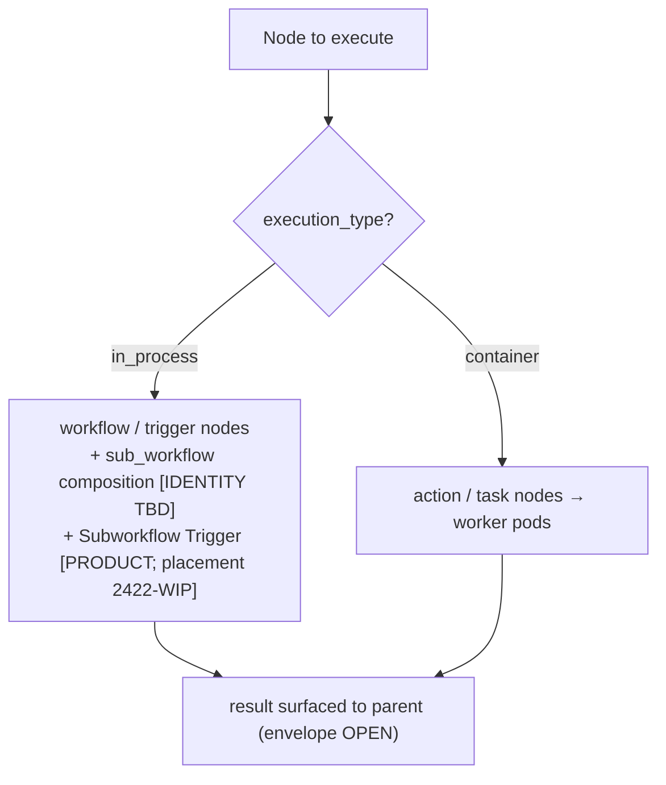
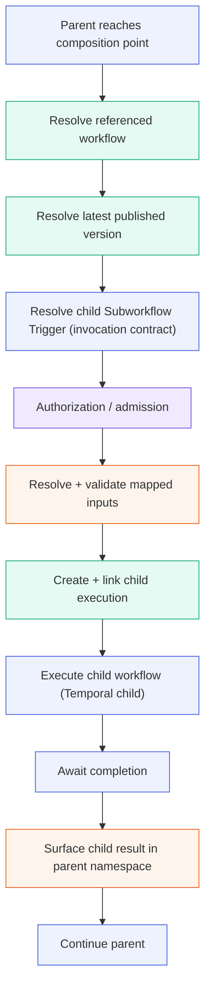
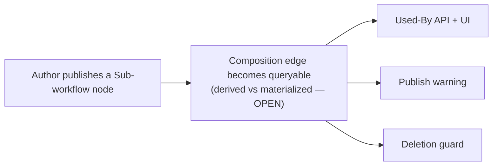
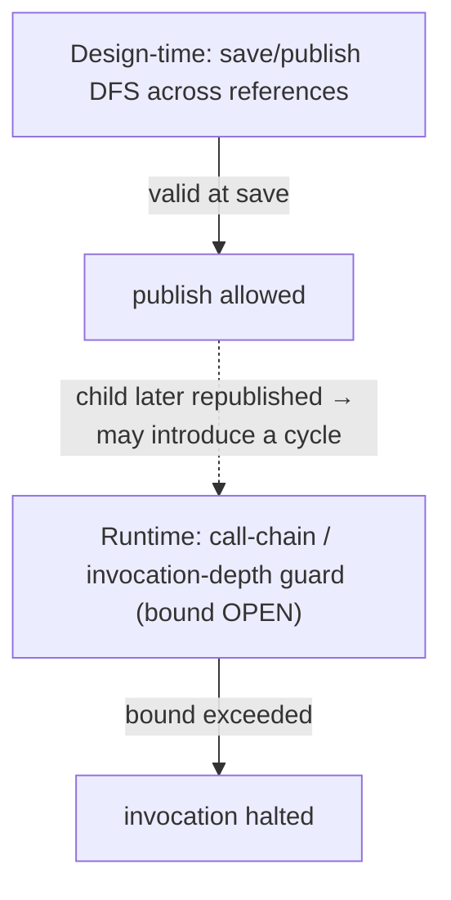
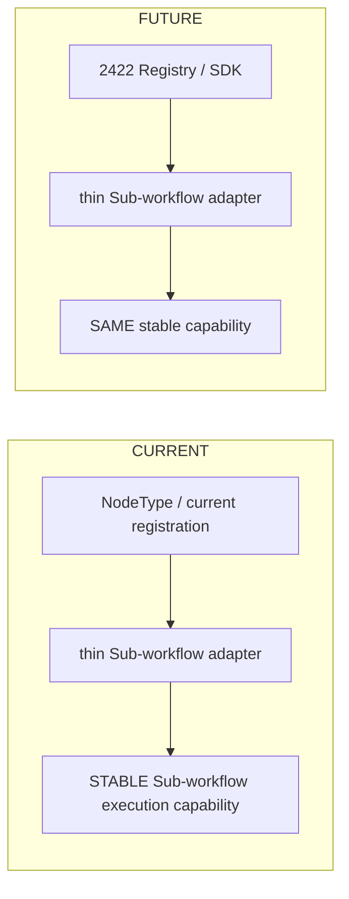

# Sub-workflow Node Architecture

The Sub-workflow Node lets an Automation Orchestrator workflow invoke another published workflow as a composable, reusable unit. This document defines the composition model (a parent-side composition point and a child-side invocation boundary), the runtime execution flow, and the versioning, dependency, and authorization semantics that make composition safe.

This design aligns with the emerging ANSTRAT-2422 Node SDK model where practical, while keeping the core 2347 runtime capability independent of unfinished SDK representation details. 2347 owns the Product and runtime composition capability; 2422 is the emerging framework/registry/SDK direction. Unfinished 2422 contracts do not automatically become 2347 contracts.

> **Feature:** ANSTRAT-2347 — Workflow Automation: Sub-workflow Node
> **Parent outcome:** ANSTRAT-2291 — Post-GA Adoption & Market Competitiveness
> **SDK direction (WIP dependency):** ANSTRAT-2422 — Automation Orchestrator Node SDK
> **Status:** Working architecture baseline — items marked OPEN are intentionally unresolved. The full evidence report and decision registers are maintained by the feature team outside this repository.

> **Product reconciliation (2026-09-15):** folds in the PM's closed decisions — trigger-based sub-workflow eligibility (the callable/runnable boolean-flag model is dropped), retry policy = standard node retry with designer-owned idempotency, published-only resolution, and cross-project *intent* (V1 scope open pending estimate). Product decided **what**; **how** (persisted identities, SDK / 2422 representation) stays OPEN.

## Source hierarchy

In decreasing authority: (1) the ANSTRAT-2347 SDP / Acceptance Criteria (Product source of truth); (2) current `origin/devel` Syntara code (verified implementation facts); (3) the ANSTRAT-2347 PoC (PoC evidence only); (4) the Sep 9 2026 architecture meeting (**meeting alignment**, not approved architecture); (5) the ANSTRAT-2422 architecture doc/branch (**WIP dependency / design direction**, not an authoritative 2347 contract); and completed research spikes (e.g. AAP-91261) where relevant.

Each section below is marked by what it describes: **[PRODUCT]** (contract), **[CODE]** (verified current code), **[POC]**, **[MEETING-ALIGNED]**, **[2422-WIP]**, **[PROPOSED]**, or **[OPEN]**.

## Decision Status

| Topic | Status | Basis |
|---|---|---|
| Synchronous child invocation | **DECIDED / Product** | SDP AC |
| Always-latest published version | **DECIDED / Product** | SDP AC (AAP-91264) |
| Reference vs Embed modes | **DECIDED / Product** | SDP AC (Embed = AAP-91282) |
| Used-By, publish warning, deletion guard | **DECIDED / Product** | SDP AC (AAP-91271/76/77/78/79) |
| Dependency / invocation resolve **published only** | **DECIDED / Product** | PM decision (partly closes DEC-008) |
| Invocation enters child via a **dedicated Subworkflow Trigger** (existence & role) | **DECIDED / Product** | PM decision (was Sep 9 MEETING-ALIGNED) |
| Eligibility is **trigger-based** (invocable as a sub-workflow iff it exposes a Subworkflow Trigger); no callable/runnable boolean flags | **DECIDED / Product** | PM decision (supersedes AAP-91270 flag framing) |
| `retry_policy` on the node behaves as on any node; repeated side effects accepted, idempotency is the designer's responsibility | **DECIDED / Product** | PM decision (closes DEC-004 at Product level; AAP-91316) |
| Input surfacing configured on the **parent Sub-workflow node only** (not promoted to parent workflow-level inputs) | **DECIDED / Product** | SDP AC-1d |
| Cross-project sub-workflows | **Product intent: cross-project; V1 scope OPEN** (pending engineering estimate) | DEC-007 |
| Subworkflow Trigger persisted identity / SDK registration / config model | **OPEN — architecture / 2422** (Product decided *that* it exists; *how* is open) | AAP-91315 / 2422 |
| Parent composition node durable identity | **OPEN — architecture** | AAP-91262 |
| Authoritative child input **schema persistence** (trigger is the boundary; where the schema lives) | **OPEN — architecture** | AAP-91261 follow-on |
| Output envelope & field names | **OPEN — architecture / 2422 alignment** | — |
| Child-start **replay-safe identity** (Temporal replay; distinct from business idempotency) | **OPEN — architecture** | AAP-91316 (architecture portion) |
| Pre-invocation contract validation (version-drift preflight) | **OPEN — architecture; PROPOSED safeguard, not a Product requirement** | — |
| Cancellation-propagation behavior | **OPEN — architecture** | DEC-001 |
| Cycle protection (two layers) | **PROPOSED architecture** | — |
| Exact nesting depth / timeout values | **OPEN — architecture/perf** | DEC-006 / AAP-92254 |
| Dependency index: derived vs materialized | **OPEN — architecture** (published-only scope decided) | DEC-002 / DEC-008 |
| Telemetry / audit event names | **OPEN — pending security review** | AAP-91238 |

## What this document deliberately does not freeze yet

- the exact parent NodeType string / persisted identity;
- the exact child Subworkflow Trigger persisted identity and configuration model;
- multiple Subworkflow Trigger support in v1;
- a `workflow_id + trigger_id` (ingress-scoped) reference model;
- the exact output envelope and field names;
- the child-start replay-safe identity scheme (Temporal); note retry policy is decided — only the replay-safe execution identity is open (§7);
- cancellation-propagation behavior;
- fixed depth / timeout values;
- SDK manifest / descriptor details.

(The callable/runnable boolean-flag fields are no longer a "not yet frozen" item — that model is dropped in favour of trigger-based eligibility; see §9.1.)

## Architecture Principles

1. **Composition Over Duplication.** A workflow author references an existing published workflow instead of copying its logic. The referenced workflow stays a first-class, independently-maintained asset; the parent gets its behavior by invocation, not duplication. **[PRODUCT]**

2. **Always-Latest Published.** A Reference-mode sub-workflow resolves its target to the target's **latest published version** at each invocation. Publishing a new version of a child updates every parent that references it, with no edit to the parent. **[PRODUCT]**

3. **Synchronous, Linked Composition.** The parent invokes the child as a **child workflow execution**, waits for its terminal result before continuing, and surfaces that result into the parent's namespace. **[PRODUCT]** The parent↔child relationship is also used for audit correlation **[PRODUCT]**; the lineage-link shape and cancellation-propagation behavior are design concerns, not yet decided **[PROPOSED / OPEN — DEC-001]**.

4. **Distinguishable Invocation via a Dedicated Trigger.** A sub-workflow invocation enters the child through a **dedicated Subworkflow Trigger**, making it distinguishable from a manual run and enabling invocation-source clarity, debugging, and permission gating. **[PRODUCT]** *(That the trigger exists and is the invocation boundary is decided; its persisted representation is an open architecture / 2422 question — see §2.2.)*

5. **Reuse the Engine's Primitives.** Composition is built from mechanisms the engine already has — workflow-plane control nodes and child workflow executions — not a new execution class, keeping the feature on well-trodden, replay-safe paths. **[CODE]** + **[PROPOSED]**

6. **Safe by Construction.** Referenced-workflow lifecycle protection (deletion blocked while referenced), execute-permission enforcement before any child starts, and dependency visibility (every composition edge queryable) are required. **[PRODUCT]** Runtime recursion/depth protection provides an additional safety boundary; the exact depth policy remains open. **[PROPOSED]**

## 1. Product Capability

### 1.1 Reference vs Embed **[PRODUCT]**

| Mode | What it is | Runtime relationship |
|------|-----------|----------------------|
| **Reference** | The parent references a target workflow and invokes it at runtime; the child always resolves to its latest published version. | Live parent↔child execution link. **This document.** |
| **Embed** | A design-time copy of a published workflow's nodes onto the parent canvas, as editable copies (AAP-91282). | None — after copy, the nodes are ordinary parent nodes. |

Embed is a builder-side transform with no runtime execution path; the rest of this document describes **Reference mode**.

### 1.2 Requirements with architectural weight **[PRODUCT]**

Synchronous composition, always-latest resolution, downstream availability of the child's result, execute-permission before invocation, trigger-based sub-workflow eligibility (a workflow is invocable as a sub-workflow when it exposes a Subworkflow Trigger — §9.1), and dependency safety (Used-By / publish warning / deletion guard) are Product requirements. How each is represented in code is addressed (and, where unresolved, left open) in the sections below. Missing Product requirements are not inferred here.

## 2. Conceptual Model: Two Roles

Sub-workflow composition has two distinct architectural roles. They are **not** the same node and should not be collapsed into one persisted identity unless architecture explicitly decides otherwise.

```text
Parent Workflow A

[Sub-workflow Composition Node]        ← parent-side: "Invoke Workflow B here."
         |
         | invokes
         v

Child Workflow B

[dedicated Subworkflow Trigger — invocation contract]  ← child-side: "B is entered as a sub-workflow through this contract."
         |
         v
      Child graph
```

### Diagram 1 — Two roles



### 2.1 Parent-side composition point **[OPEN identity]**

A control-plane node in the parent that says "invoke Workflow B here." Its durable node identity is **not yet decided** (AAP-91262). This document uses `sub_workflow` as a neutral placeholder: `[PLACEHOLDER — FINAL NODE IDENTITY TBD]`.

### 2.2 Child-side invocation boundary **[PRODUCT — trigger is the boundary; representation OPEN]**

Product has decided that a sub-workflow invocation enters the child through a **dedicated Subworkflow Trigger** — this is the invocation boundary, and it is what makes a sub-workflow run distinguishable from a manual run. This supersedes the Sep 9 "distinguishable invocation" *meeting alignment*, which is now a closed Product decision (the WHAT).

> **[PRODUCT] — what.** Product has decided the *semantic model* of the Subworkflow Trigger:
> - a workflow is invocable as a sub-workflow **only if** it exposes a dedicated Subworkflow Trigger;
> - a sub-workflow may be entered **only** through that Subworkflow Trigger;
> - a Subworkflow Trigger may be invoked **only** by a Sub-workflow node;
> - generic workflow triggers (manual / webhook / EDA / scheduled) **do not** establish sub-workflow eligibility.
>
> This is the invocation boundary and the basis for eligibility (§9.1).
> **[OPEN — architecture / 2422] — how:** the trigger's persisted node type, any SDK registration mechanism, its descriptor / manifest, its configuration model, multiple-Subworkflow-Trigger behavior, and its ANSTRAT-2422 representation are **not** decided here.

### 2.3 Why they are distinct

The parent node is a *caller*; the child ingress is an *entry contract*. Conflating them would, for example, make the parent's node identity depend on the child's trigger representation. Keeping them separate lets each evolve under its own open decision.

### 2.4 Where this stands today: current vs PoC vs target

To prevent any reader from assuming `subworkflow_trigger` or a Reference-mode composition node already exists in production, the evolution is explicit:

```text
CURRENT PRODUCTION  [CODE]
  Parent workflow
        |
        X   no production Reference-mode Sub-workflow composition capability
  Child workflow
        |
  Existing trigger mechanisms only (manual / webhook / EDA / scheduled)

POC / RESEARCH  [POC]  — evidence only, NOT final architecture
  Parent
  [Sub-workflow placeholder]
        |
        v
  Child entry selection via triggers[0] fallback   (order-dependent; §4.4)

TARGET DIRECTION  [PRODUCT: boundary decided; representation OPEN]
  Parent
  [Sub-workflow composition point]        (identity TBD — §2.1)
        |
        v
  [dedicated Subworkflow Trigger — the invocation boundary]   (representation OPEN — §2.2)
        |
        v
  Child graph
```

The Subworkflow Trigger *boundary* is now a closed Product decision, but **nothing in "Target direction" is implemented in production today**; `triggers[0]` remains PoC/research behavior, not the decided mechanism's implementation.

## 3. Placement in the Platform (Taxonomy) **[2422-WIP proposal]**

Where practical, the two roles align with the emerging 2422 category model: a control-plane composition node and a trigger-category child ingress, both running in-process (no isolated runtime to provision). The child *workflow* may itself contain container-backed `action`/`task` nodes, dispatched to the execution plane as usual; composition adds no container of its own. This alignment is a **proposal toward 2422 compatibility**, not a 2422 contract 2347 is bound by.



## 4. Child Invocation Contract

Two different kinds of data must not be conflated: the **business invocation contract** the parent author sees, and the **internal execution context** the orchestrator manages.

### 4.1 Caller / business invocation schema **[PRODUCT boundary; schema persistence OPEN]**

The author-facing contract: "what inputs does Child B expose?" This is domain data, e.g.:

```text
customer_id
region
environment
```

The **dedicated Subworkflow Trigger is the invocation boundary that owns this business contract** (Product decision — §2.2). *Where and how* the schema is persisted and represented (trigger descriptor, SDK schema, etc.) remains an open architecture / 2422 question.

### 4.2 Internal execution context **[PROPOSED — not public inputs]**

Orchestration metadata the engine manages, **not** a user-authored input contract:

```text
parent_execution_id
actor identity
resolved child published version
invocation depth
request / correlation id
```

Fields such as `parent_execution_id`, recursion depth, timeout, and context-propagation controls belong here (or to node settings / platform configuration), **not** to the public Subworkflow Trigger input schema, unless Product/approved architecture says otherwise.

### 4.3 Input mapping **[PRODUCT surface; POC mechanism]**

The AAP-91261 spike findings hold: input mappings are **node-local**; a model like `input_mapping: dict[str, Any]` is reasonable; the existing `${...}` expression machinery can be reused; and **child-required inputs do not automatically mutate the parent workflow's workflow-level input contract**. The behavior of *extra or unmapped* inputs is governed by the child's schema validation — it is not assumed harmless, and its exact semantics follow the input-schema decision (§4.1). Three questions stay separate:

```text
What inputs does Child B expose?   → invocation schema (§4.1)
Where is that contract declared?    → architecture / possibly Subworkflow Trigger + SDK
Where does Parent A's user map them?→ Product UX on the Sub-workflow node
```

Per **AC-1d**, input surfacing and mapping are configured on the **parent Sub-workflow node only** and are **not** promoted to the parent workflow's workflow-level input contract. **[PRODUCT]** This Product decision (input surfacing and mapping are configured on the parent Sub-workflow node) is distinct from the open architecture question of *where the child's schema is persisted* (§4.1).

### 4.4 Entry-point selection **[POC]**

The PoC uses `triggers[0]` to pick the child's entry point. This is a **PoC/current fallback only**: it is order-dependent and not a durable contract-selection mechanism. Product has decided the dedicated Subworkflow Trigger **is** the invocation boundary / authoritative ingress (§2.2); `triggers[0]` is only PoC scaffolding standing in for it. What remains **[OPEN — architecture]** is the trigger's persisted representation and the resolution mechanism, not whether the trigger is the ingress.

## 5. Output Handling **[OPEN / 2422 alignment]**

**[PRODUCT]** The child's result must be available to downstream parent nodes.

**[OPEN]** The exact durable output envelope is not prescribed by 2347 ACs. ANSTRAT-2422 currently proposes a `StandardOutputWrapper` (`Result`, `StatusCode`, `StatusMessage`, `ErrorMessage`), but that is **[2422-WIP]** and must not be frozen as the 2347 contract. Persisted field names (`Result`, `outputs`, `output`, `child_status`, …) are not frozen until aligned.

**[POC / AAP-91261]** Reusing dotted-path expression resolution for child outputs is a valid spike finding. Note, however, that any concrete accessor we publish *is itself a commitment*: writing `${subwf.Result.*}` already commits to a field named `Result`. A genuine compatibility seam would therefore have to surface child output through an indirection that does **not** bake a field name into author-visible expressions (for example, resolving a logical "child result" reference that maps onto whichever envelope is finally chosen). Until such a seam is designed and agreed, no claim that the accessor "protects us from future SDK changes" holds.

## 6. Runtime Execution Flow (the stable architectural core) **[PROPOSED on CODE]**

This sequence is the stable core of the feature and is designed to survive migration from the current node framework to ANSTRAT-2422 (§12).



Responsibility lanes:

| Step | Responsibility |
|------|----------------|
| Reach composition point; determine entry contract; execute & await child; continue | **Temporal workflow logic** (deterministic, replay-safe) |
| Resolve referenced workflow; resolve latest published version; create + link child execution | **Database work** (read sessions not held across the child-start RPC, per the existing scheduled-launch pattern) |
| Resolve + validate mapped inputs; surface child result | **Activity / backend-service work** |
| Authorization / admission | **Authorization / policy boundary** — Subworkflow-Trigger eligibility/admission **and** execute-permission, both before the child starts |

**Replay-safety correctness invariant.** A replayed parent must **not** create a duplicate child execution — replaying parent logic re-drives the same single child, never a second one. This correctness property (concern **A**) must hold, and is **distinct from** the node's retry policy (concern **B**, a Product decision — §7) and business idempotency (concern **C**, the designer's responsibility — §7). **The invariant is what must hold; the mechanism that enforces it is OPEN:** the concrete child-start identity scheme (e.g. a derived child workflow id) is **[OPEN — architecture]** and not frozen here.

## 7. Failure, Retry & Idempotency **[PRODUCT retry policy; architecture replay identity]**

Three concerns must be distinguished and **not** collapsed:

- **A — Temporal replay safety** *(architecture)*: a *replayed* parent must not start a duplicate child (§6). This is a determinism property of the engine, not a user-facing retry.
- **B — Node retry policy** *(Product-decided)*: `retry_policy` on the Sub-workflow node behaves **as on any other node**. Product has accepted that an intentional retry may re-run a child that already performed work — i.e. **repeated side effects are accepted**.
- **C — Business idempotency** *(designer's responsibility, Product-decided)*: making a child safe to invoke more than once is the **workflow designer's** responsibility, not a guarantee the platform provides.

`continue_on_failure` is a **separate** concern again: it controls whether downstream parent nodes run after a failure; it does not retry anything.

**Replay safety (A) is not business idempotency (C).** Replay-idempotency prevents a *replayed* parent from creating a duplicate child; it does **not** prevent **duplicate business side effects** when a retry (B) intentionally re-runs a child that already performed side effects. **Deterministic child IDs address A, not C** — they must not be presented as a solution to business idempotency.

**Status.** The earlier tension between SDP **AC-4a** ("`retry_policy` must work on Sub-workflow nodes") and **DEC-004 / AAP-91316** is **resolved at the Product level**: retry behaves as on any node, repeated side effects are accepted, and idempotency is the designer's responsibility. **[PRODUCT]** What remains open is purely architectural — the **replay-safe child-start identity** (A) — tracked under AAP-91316's architecture portion. **[OPEN — architecture]**

ANSTRAT-1779 (retry-from-failure / stalled-workflow detection) is a **retry/resilience-related dependency**; this document does not assert that 1779 "owns" sub-workflow retry absent explicit documentation.

## 8. Versioning & Dependency Safety

### 8.1 Always-latest resolution **[PRODUCT]**

Each invocation resolves the child's current published version. A workflow has at most one published version at a time; publishing a new child version is immediately picked up by every referencing parent. Resolution and dependency checks operate on **published workflows only** (Product decision); drafts are not invocation targets. **[PRODUCT]**

### 8.2 Dependency must be queryable **[PRODUCT]**

Product requires that every composition edge (parent references child) is **queryable as a workflow dependency**, supporting:

- **Used-By view** — which workflows reference this one (detail page + list count);
- **Publish warning** — when publishing a workflow that is referenced by sub-workflow nodes;
- **Deletion guard** — deleting a workflow is **blocked** while actively referenced.

### 8.3 Persistence mechanism & timing **[OPEN — architecture]**

The **published-only** scope is decided (Product — §8.1). What remains open is whether dependency data is **derived** from workflow definitions or **materialized** in a dedicated index, and the exact write timing within the published lifecycle (DEC-002 / DEC-008). That choice sets how strict and how timely the deletion guard and warnings are.



### 8.4 Version drift — needs a runtime correctness boundary

Because Reference mode always resolves the *latest published* child (§8.1), design-time validation alone **cannot** guarantee compatibility. Concretely:

```text
Parent A is validated against Child B v3.
Later, B v4 is published with a new required input.
A executes — without ever being reopened in the builder.
```

So drift handling has two distinct layers:

- **Design time — early compatibility feedback.** When an author edits the parent, the builder surfaces the child's *current* contract and flags mappings that no longer fit; publish warnings flag parents affected by a child change. This catches drift early but cannot catch a child republished *after* the parent was last edited.
- **Runtime — clear failure on incompatibility (Product); validation mechanism (architecture).** A latest-published child change can make an existing parent incompatible; Product treats this as **workflow-design compatibility**. **[PRODUCT]** If execution then fails because of the change, the failure must be **clear and actionable** (an error naming the specific mismatch), and the UI **may** notify users that a referenced workflow changed. **[PRODUCT]** Product has **not** mandated *pre-invocation* schema validation; a preflight check that validates mapped inputs against the resolved child contract *before* the child starts is a useful but **PROPOSED / OPEN architecture** safeguard, not a Product requirement.

Whether a preflight check is implemented, and where it runs, is an open architecture decision and is not over-specified here.

## 9. Authorization & Lifecycle Safety

### 9.1 Sub-workflow eligibility is trigger-based **[PRODUCT]**

A workflow is invocable as a sub-workflow **because it exposes a dedicated Subworkflow Trigger** (§2.2) — **not** because of a separate `callable` / `runnable` boolean flag. The earlier two-boolean capability model (`allow_as_subworkflow`, `runnable_independently`) is **dropped**. Reciprocally, a sub-workflow may be entered **only** through its Subworkflow Trigger, and a Subworkflow Trigger may be invoked **only** by a Sub-workflow node; generic triggers do **not** confer eligibility (§2.2). **[PRODUCT]**

```text
Can this workflow be invoked as a sub-workflow?  → yes iff it has a Subworkflow Trigger
Can this workflow be started independently?       → governed by its other triggers (manual / webhook / EDA / scheduled)
```

A workflow with *only* a Subworkflow Trigger is effectively invocation-only (no independent-start trigger); one with a Subworkflow Trigger **and**, say, a manual trigger is both. Exposing reusable units without exposing their internals remains the product rationale **[MEETING-ALIGNED MA-6]**. **Embed-mode eligibility is separate**: Embed is a design-time import of a published workflow's nodes (§1.1) and is **not** governed by the Subworkflow Trigger or by any invocation flag.

### 9.2 Representation **[PRODUCT eligibility model; trigger representation OPEN]**

Eligibility representation is **trigger-based** and decided (§9.1): presence of a Subworkflow Trigger. There is no separate callable/runnable capability-flag schema. What remains open is the **Subworkflow Trigger's own persisted representation** (persisted node type, SDK registration, config model), tracked in §2.2 / §13.

### 9.3 Execute-permission **[PRODUCT]**

Independently of admission, the invoking actor must hold execute-permission on the child before child execution starts. **[PRODUCT]** The platform already provides an RBAC/authorization substrate **[CODE]**; the concrete RBAC/Rego policy contract and enforcement seam for sub-workflow invocation are being resolved by the AuthZ spike (AAP-91260). **[OPEN]**

### 9.4 Child-metadata disclosure — proposed security invariant **[PROPOSED]**

Distinct from the UX (§11): the proposed architecture puts forward — as a **security invariant awaiting architecture/Pod ratification** — that **child metadata used for input/output discovery must be exposed only through the applicable authorization boundary**, so an author who lacks the relevant permission on the child cannot obtain the child's internal contract through the composition surface. Once ratified it becomes a security invariant; until then it is proposed. The *way* it is surfaced to the user is a UX choice (§11), separate from the invariant itself.

## 10. Cycle & Depth Protection **[PROPOSED; depth number OPEN]**

The proposed architecture uses two complementary protection layers:

```text
Design-time:  save/publish DFS across workflow references
Runtime:      call-chain / invocation-depth guard
```

The two layers are complementary because a dependency graph that is acyclic at save time **can become cyclic after a referenced child is later republished** — so a runtime guard is the backstop the static check cannot provide.



The proposed architecture includes runtime recursion/cycle protection; the **maximum allowed nesting depth is an open architecture/performance decision** (DEC-006 / AAP-92254) and no specific number is fixed here.

## 11. Frontend / Builder UX **[PRODUCT + PROPOSED]**

Palette entry with a reference-configuration form; a variable picker to map parent values into the child (rendered from the child's current input schema); a nested output picker over the child's result shape (expression syntax itself is open, DEC-011); and inline expansion of child results in the execution view.

When an author references a child they lack permission on, the proposed security invariant is §9.4 (metadata only through the authorization boundary). *How* that is represented is a **[PROPOSED]** UX choice — an access indicator, a disabled state, or an equivalent treatment — and is not itself part of the architecture unless Product decides a specific treatment.

## 12. Migration Seam to ANSTRAT-2422 **[PROPOSED]**

The single most important 2422-aware goal: keep node **registration/identity** thin and replaceable over a **stable execution capability**.



**Stable capability owns** (does not change across the migration): latest-version resolution, authorization/admission, input mapping, input validation, child execution creation, lineage, Temporal child invocation, result/error handling.

**Replaceable layer contains** (swaps when 2422 lands): node registration, node identity representation, schema registration, palette metadata, SDK descriptor/manifest representation.

Designing to this seam is what lets 2347 ship on the current framework now and migrate to the SDK later without reworking the runtime core.

## 13. Open Architectural Decisions

| Decision | Status | Owner / ticket |
|----------|--------|----------------|
| Subworkflow Trigger representation (persisted identity, SDK registration, config model) | OPEN — architecture / 2422 (existence & role Product-decided) | AAP-91315 / 2422 |
| Parent composition node durable identity | OPEN — architecture | AAP-91262 |
| Authoritative child invocation **schema persistence** (trigger is the boundary) | OPEN — architecture | AAP-91261 follow-on |
| Output envelope & field names | OPEN — architecture / 2422 alignment | — |
| Child-start **replay-safe identity** (Temporal) | OPEN — architecture (distinct from business idempotency, which Product assigns to the designer) | AAP-91316 (arch) |
| Pre-invocation contract validation (version-drift preflight) | OPEN — architecture; PROPOSED safeguard, not a Product requirement | — |
| Max nesting depth / timeout values | OPEN — architecture/perf | DEC-006 / AAP-92254 |
| Dependency data: derived vs materialized (published-only scope decided) | OPEN — architecture | DEC-002 / DEC-008 |
| Cross-project scope | Product intent: cross-project; **V1 scope OPEN pending engineering estimate** | DEC-007 |
| Lineage link shape + child actor identity | OPEN — architecture | DEC-001 / AAP-91314 |
| Cancellation-propagation behavior | OPEN — architecture | DEC-001 |
| Multiple Subworkflow Trigger support | OPEN — architecture / future (not v1) | — |
| Telemetry / audit event names | OPEN — pending security review | AAP-91238 |

Once an OPEN decision closes, this table is updated; detailed decision history remains in the feature team's companion decision registers.

On **cross-project scope**: Product intends sub-workflows to work across projects; the **V1 scope is OPEN pending an engineering estimate** — this document does *not* propose a same-project-only v1. Architecture cost drivers feeding that estimate: cross-project execute-permission / RBAC evaluation (§9.3), cross-project dependency indexing and deletion guards (§8.2), cross-project metadata-disclosure boundaries (§9.4), project-scoped resolution of the child's latest published version (§8.1), and audit / lineage across project boundaries (§3, §13).

## 14. Related Initiatives

| Key | What | Relevance |
|-----|------|-----------|
| **ANSTRAT-2291** | Post-GA Adoption & Market Competitiveness (parent outcome) | Sub-workflows are a reuse/competitiveness capability. |
| **ANSTRAT-2422** | Automation Orchestrator Node SDK | Emerging taxonomy/registry/envelope direction; WIP; informed by this work. Not an authoritative 2347 contract. |
| **ANSTRAT-1934** | Kafka Subscribe/Publish nodes | Parallel extension of the trigger surface (Kafka Subscribe is a trigger). |
| **ANSTRAT-1803** | Execution Plane (On-Cluster OpenShift) | Runs the child's container nodes. |
| **ANSTRAT-1779** | Retry from Failure & Stalled-Workflow Detection | Retry/resilience-related **dependency** (not documented owner of sub-workflow retry). |
| **ANSTRAT-1900 / 1740** | RBAC & Audit (delivered) | Shipped substrates for execute-permission and audit/telemetry. |

## 15. Examples

Parent composition node and child ingress are **different** definitions. Node identities below are placeholders/proposals, not final.

```yaml
# Parent Workflow A  —  composition node

- id: process_payment
  type: sub_workflow        # [PLACEHOLDER — FINAL NODE IDENTITY TBD]
  parameters:
    workflow_id: "a1b2c3d4-e5f6-4a5b-8c9d-0e1f2a3b4c5d"   # child definition (resolved to latest published)
    input_mapping:          # node-local mapping (AAP-91261); reuses ${...}
      order_id: "${trigger.order_id}"
      amount: "${validate_order.total_amount}"
  # settings: continue_on_failure, retry_policy.
  # retry_policy = standard node retry (Product-decided, §7); business idempotency is the
  # designer's responsibility; only the Temporal child-start replay identity is OPEN.
```

```yaml
# Child Workflow B  —  invocation boundary

trigger:
  type: subworkflow_trigger   # Subworkflow Trigger — role Product-decided; persisted representation OPEN (§2.2)
  input_schema:               # business invocation contract (§4.1)
    order_id:
      type: string
      required: true
    amount:
      type: number
      required: true
# internal execution context (parent_execution_id, depth, actor, resolved version,
# correlation id) is orchestration metadata — NOT part of this public input schema (§4.2)
```

> The parent composition node is **not** the child ingress trigger. They remain distinct roles unless architecture explicitly decides to share one persisted identity.

## 16. Questions requiring ANSTRAT-2422 / architecture alignment

Product intent is settled for each item below; each still needs an architecture / 2422 decision before implementation. Format: *Product has decided* → *architecture still needs* → *why 2422 input is needed*.

| Topic | Product has decided | Architecture still needs | Why 2422 input is needed |
|---|---|---|---|
| Parent node identity / registration | a parent composition node exists and invokes the child | its persisted NodeType / registration | 2422 owns node registration & identity representation |
| Subworkflow Trigger SDK representation | the trigger exists and is the invocation boundary | its persisted identity + SDK descriptor | 2422 defines trigger-category nodes & registration |
| Trigger input-schema representation | the trigger owns the business invocation contract | where / how the schema is persisted | 2422 schema / descriptor model may own this |
| Output envelope | the child result must reach downstream parent nodes | the durable envelope + field names | 2422 proposes `StandardOutputWrapper` |
| execution_type / category placement | composition is in-process; child containers run as usual | the node's category / execution_type tags | 2422 taxonomy defines these |
| Child execution / lineage model | synchronous linked child execution + audit correlation | the persisted lineage link shape + actor identity | must fit the 2422 execution / telemetry model |
| Retry-attempt identity vs Temporal replay identity | retry = standard node retry; idempotency is the designer's | the replay-safe child-start identity | interacts with the 2422 execution / child-start model |
| Multiple Subworkflow Trigger semantics | not required for v1 | whether / how multiple ingresses are supported later | 2422 trigger model governs multiplicity |
| Migration seam | ship on current framework, migrate to the SDK later | the thin registration / identity adapter boundary | seam must map onto the 2422 registry / SDK |

---

*Target-state architecture for the ANSTRAT-2347 Sub-workflow Node. Items marked OPEN are not final and will be updated as the remaining Product/architecture decisions close.*
